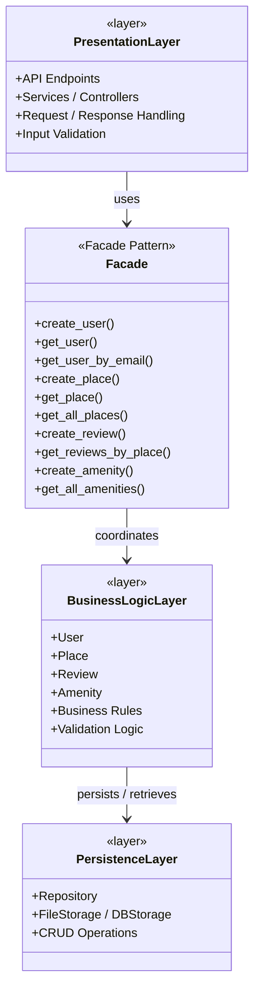
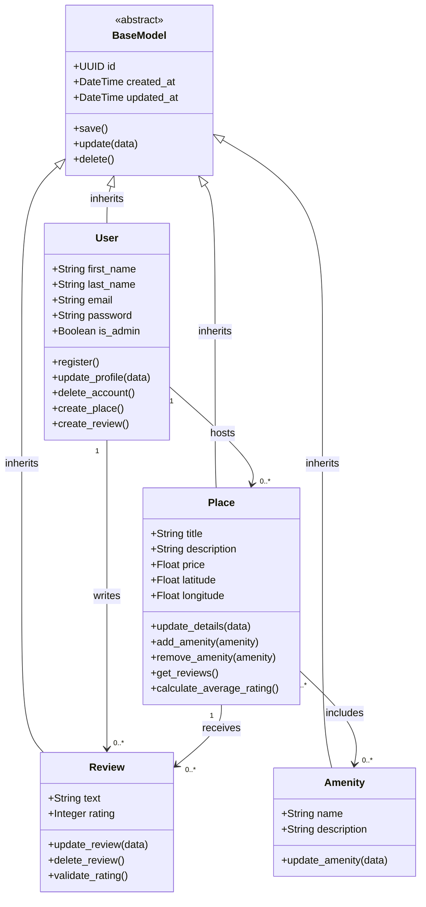

# High-Level Package Diagram for Holberton HBnB (Task-0)

---

## What is the HBnB Project?
>HBnB is a simplified version of Airbnb, is for the Holberton student make a replica of it like a final project.

**Users can:**
- Create accounts
- List places (apartments, houses, etc.)
- Add amenities
- Write reviews
- Search and view places

## The Three-Layer Architecture
The application is organized into 3 layers. Each layer has a clear responsibility and should not do the work of another layer:

- **Presentation Layer-** Talks to the outside world (users / frontend)
- **Business Logic Layer-** Contains the real rules and entities of the app
- **Persistence Layer-** Saves and loads data

# Responsibilities of Each Layer:

  ## Presentation Layer
  - Receives HTTP requests
  - Validates input format
  - Calls the Facade
  - Returns JSON responses + status codes
  - Should never contain business rules

  ## Business Logic Layer
  - Contains the models (User, Place, Review, Amenity)
  - Contains business rules (example: a user cannot review their  own place)
  - Knows the relationships between entities

  ## Persistence Layer
  - Responsible only for saving and retrieving data
  - Can be:
    - File storage (JSON)
    - Database (SQLAlchemy / MySQL)
  - The rest of the application should not care which one is used

    ---

    # High-Level Package Diagram

  
---

# Business Logic Layer for Holberton HBnB (Task-1)

---

## Project Overview
>The objective of this project is to design a detailed UML Class Diagram representing the **Business Logic Layer** of the HBnB application.

>**BaseModel** is the parent class inherited by all four main entities. It provides common attributes and methods, avoiding code duplication.

The diagram illustrates the internal structure of the application, focusing on its four main entities:

* **User:** Represents registered users of the application.

* **Place:** Represents accommodation listings created by users.

* **Review:** Represents feedback and ratings submitted by users.

* **Amenity:** Represents facilities and features available at places.

## The Core Entities

1. **User**
    - Represents registered users (guests or hosts).
    - Key attributes: unique id (UUID4), email (unique), password (hashed in real implementations), names, is_admin flag, and the mandatory created_at / updated_at timestamps.
    - Core methods: CRUD operations (create, update, delete), serialization (to_dict), and validation.
    - Role: Owns places and authors reviews.

2. **Place**
    - Core entity representing a rental listing.
    - Key attributes: title/description, price, geolocation (latitude/longitude), capacity (max_guests, rooms, bathrooms), reference to the owner (owner_id), and timestamps.
    - Methods include standard CRUD + helpers for managing the many-to-many relationship with amenities.
    - Role: Belongs to one User (owner), can receive many Reviews, and can have many Amenities.

3. **Review**
    - User-generated feedback for a place.
    - Key attributes: review text, numeric rating (typically 1–5), foreign keys to User and Place, and timestamps.
    - Methods: standard CRUD + validation (e.g., rating range, ownership rules).
    - Role: Links a User to a Place. Business rules usually enforce: one review per user per place, and owners cannot review their own places.

4. **Amenity**
    - Catalog of features (WiFi, Pool, Parking, etc.).
    - Simple entity with id, name, and timestamps.
    - Role: Shared across places via a many-to-many association (implemented with a junction table such as place_amenity in the persistence layer).

---

# Business Logic Layer: Class Diagram

---

## Author
>Developed by Tasha Arroyo, a Holberton School student 
