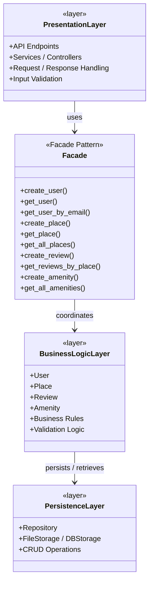
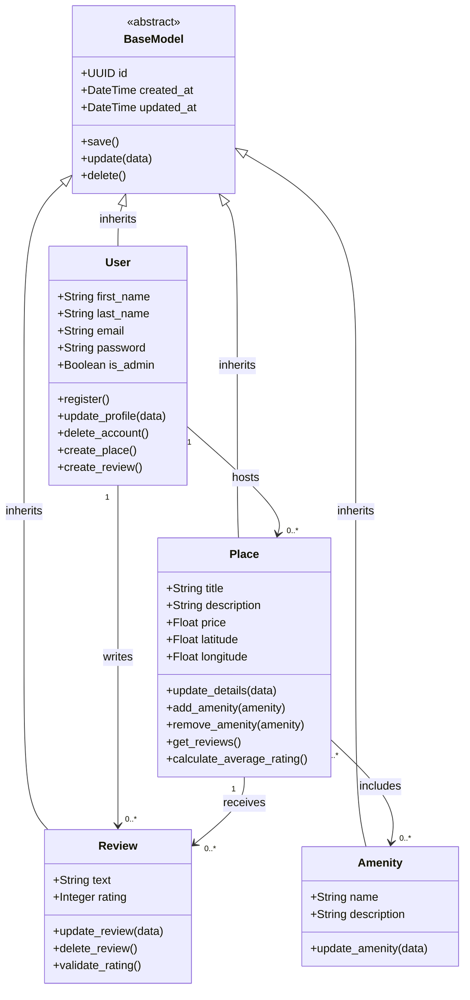
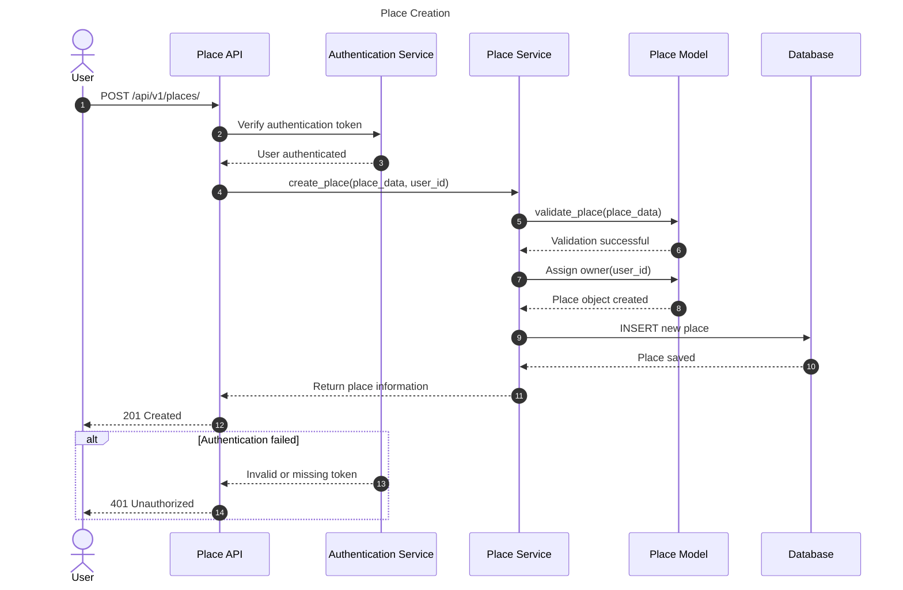
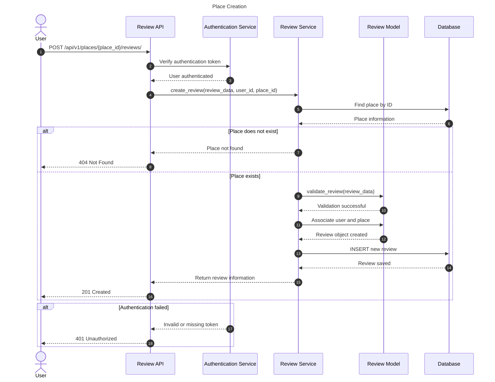
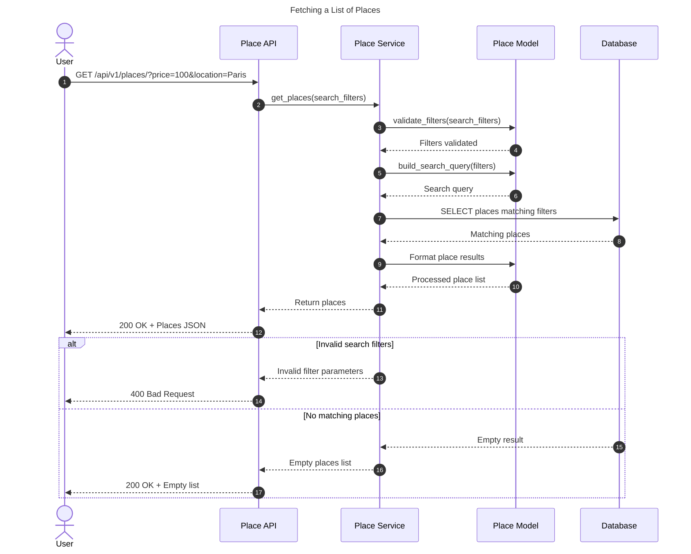
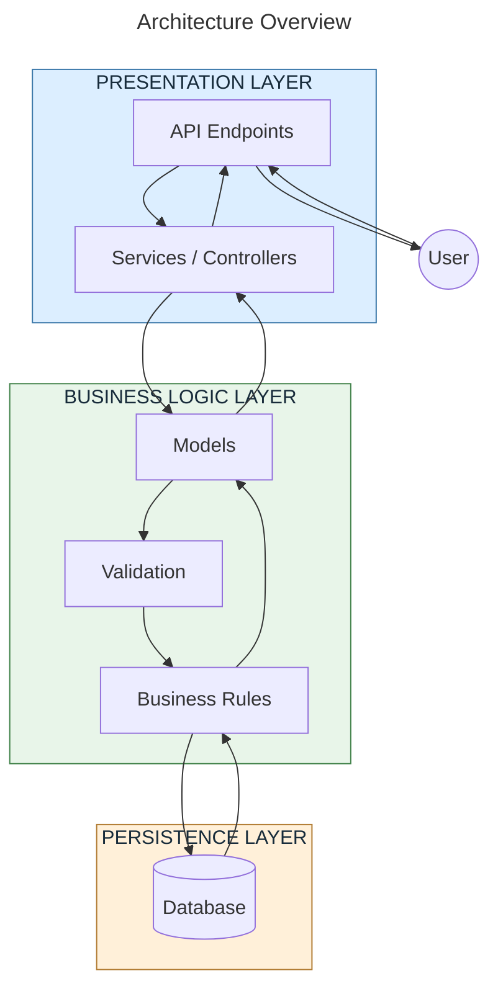

# High-Level Package Diagram for Holberton HBnB (Task-0)

---

## What is the HBnB Project?
>HBnB is a simplified version of Airbnb, is for the Holberton student make a replica of it like a final project.

**Users can:**
- Create accounts
- List places (apartments, houses, etc.)
- Add amenities
- Write reviews
- Search and view places

## The Three-Layer Architecture
The application is organized into 3 layers. Each layer has a clear responsibility and should not do the work of another layer:

- **Presentation Layer-** Talks to the outside world (users / frontend)
- **Business Logic Layer-** Contains the real rules and entities of the app
- **Persistence Layer-** Saves and loads data

# Responsibilities of Each Layer:

  ## Presentation Layer
  - Receives HTTP requests
  - Validates input format
  - Calls the Facade
  - Returns JSON responses + status codes
  - Should never contain business rules

  ## Business Logic Layer
  - Contains the models (User, Place, Review, Amenity)
  - Contains business rules (example: a user cannot review their  own place)
  - Knows the relationships between entities

  ## Persistence Layer
  - Responsible only for saving and retrieving data
  - Can be:
    - File storage (JSON)
    - Database (SQLAlchemy / MySQL)
  - The rest of the application should not care which one is used

    ---

    # High-Level Package Diagram

  
---

# Business Logic Layer for Holberton HBnB (Task-1)

---

## Project Overview
>The objective of this project is to design a detailed UML Class Diagram representing the **Business Logic Layer** of the HBnB application.
    **BaseModel** is the parent class inherited by all four main entities. It provides common attributes and methods, avoiding code duplication.

The diagram illustrates the internal structure of the application, focusing on its four main entities:

* **User:** Represents registered users of the application.

* **Place:** Represents accommodation listings created by users.

* **Review:** Represents feedback and ratings submitted by users.

* **Amenity:** Represents facilities and features available at places.

## The Core Entities

1. **User**
    - Represents registered users (guests or hosts).
    - Key attributes: unique id (UUID4), email (unique), password (hashed in real implementations), names, is_admin flag, and the mandatory created_at / updated_at timestamps.
    - Core methods: CRUD operations (create, update, delete), serialization (to_dict), and validation.
    - Role: Owns places and authors reviews.

2. **Place**
    - Core entity representing a rental listing.
    - Key attributes: title/description, price, geolocation (latitude/longitude), capacity (max_guests, rooms, bathrooms), reference to the owner (owner_id), and timestamps.
    - Methods include standard CRUD + helpers for managing the many-to-many relationship with amenities.
    - Role: Belongs to one User (owner), can receive many Reviews, and can have many Amenities.

3. **Review**
    - User-generated feedback for a place.
    - Key attributes: review text, numeric rating (typically 1–5), foreign keys to User and Place, and timestamps.
    - Methods: standard CRUD + validation (e.g., rating range, ownership rules).
    - Role: Links a User to a Place. Business rules usually enforce: one review per user per place, and owners cannot review their own places.

4. **Amenity**
    - Catalog of features (WiFi, Pool, Parking, etc.).
    - Simple entity with id, name, and timestamps.
    - Role: Shared across places via a many-to-many association (implemented with a junction table such as place_amenity in the persistence layer).

---

# Business Logic Layer: Class Diagram

---

# Sequence Diagrams for Holberton HBnB (Task-2)

---

## What for the Sequence Diagrams? 
>Illustrate the interactions between the Presentation, Business Logic, and Persistence layers of the HBnB application.

   - Each diagram demonstrates how an API request is received, validated, processed, and communicated with the database before returning a response to the client.
   - These diagrams also demonstrate the importance of separating responsibilities between the layers, making the application easier to maintain, test, and extend.
   - Important implementation note: These diagrams represent the intended architectural flow. Adapt service and model method names to match your actual HBnB implementation.

Below are four UML sequence diagrams for the HBnB application using Mermaid.js. They illustrate how the Presentation Layer, Business Logic Layer, and Persistence Layer interact to process API requests.

## 1. User Registration
**Objective:** Illustrate how a new user creates an account in HBnB.

**API Endpoint:** POST /api/v1/users/

### Description:
1. The user submits registration information (first name, last name, email, and password).
2. The API receives the request and forwards the information to the User model through the business logic layer.
3. The business logic validates the information and checks whether the email is already registered.
4. The database searches for an existing user with the same email.
5. If the email is available, the password is hashed and the new user is saved.
6. The API returns a successful response with the new user's information.

### Diagram:

```mermaid
---
title: User Registration
---

   sequenceDiagram
    autonumber
    actor User
    participant API as User API
    participant Service as User Service
    participant Model as User Model
    participant DB as Database

    User->>API: POST /api/v1/users/
    API->>Service: register_user(user_data)
    Service->>Model: validate_user(user_data)
    Model-->>Service: Validation successful

    Service->>DB: Check if email exists
    DB-->>Service: Email availability

    alt Email already exists
        Service-->>API: Email already registered
        API-->>User: 409 Conflict
    else Email is available
        Service->>Model: Hash password
        Model-->>Service: Hashed password
        Service->>DB: INSERT new user
        DB-->>Service: User created
        Service-->>API: Return user information
        API-->>User: 201 Created
    end
```

## 2. Place Creation
**Objective:** Illustrate how an authenticated user creates a new place listing.

**API Endpoint:** POST /api/v1/places/

### Description:
1. The user submits place information, including title, description, price, and location.
2. The API receives the request and verifies the user's authentication.
3. The business logic validates the submitted information.
4. The Place model processes the data and associates the listing with its owner.
5. The database saves the new place.
6. The API returns the newly created place information.

### Diagram:

## 3. Review Submission
**Objective:** Illustrate how a user submits a review for an existing place.

**API Endpoint:** POST /api/v1/places/{place_id}/reviews/

### Description:
1. The user submits a review containing a rating and written comment.
2. The API receives the request and verifies the user's authentication.
3. The Review Service validates the review information.
4. The business logic checks whether the requested place exists.
5. The Review model verifies the rating and associates the review with the user and place.
6. The database stores the review.
7. The API returns a successful response.

### Diagram:

## 4. Fetching a List of Places
**Objective:** Illustrate how a user retrieves a list of places based on search criteria.

**API Endpoint:** GET /api/v1/places/

### Description:
1. The user sends a request to retrieve available places, optionally including filters such as price, location, or number of guests.
2. The API receives the request and forwards the search criteria to the Place Service.
3. The business logic validates and processes the search filters.
4. The Place model prepares the query.
5. The database retrieves matching places.
6. The business logic processes the retrieved information.
7. The API returns the list of matching places to the user.

### Diagram:

## The four diagrams demonstrate how the three main layers of the HBnB application communicate.

---

## Author
>Developed by Tasha Arroyo, a Holberton School student 
