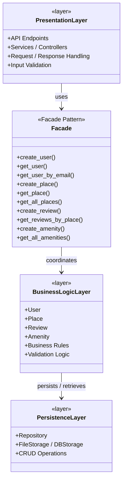

# High-Level Package Diagram for Holberton HBnB (Task-0)

---

## What is the HBnB Project?
>HBnB is a simplified version of Airbnb, is for the Holberton student make a replica of it like a final project.

Users can:
- Create accounts
- List places (apartments, houses, etc.)
- Add amenities
- Write reviews
- Search and view places

## The Three-Layer Architecture
The application is organized into 3 layers. Each layer has a clear responsibility and should not do the work of another layer:

- Presentation Layer- Talks to the outside world (users / frontend)
- Business Logic Layer- Contains the real rules and entities of the app
- Persistence Layer- Saves and loads data

# Responsibilities of Each Layer:

  ## Presentation Layer
  - Receives HTTP requests
  - Validates input format
  - Calls the Facade
  - Returns JSON responses + status codes
  - Should never contain business rules

  ## Business Logic Layer
  - Contains the models (User, Place, Review, Amenity)
  - Contains business rules (example: a user cannot review their  own place)
  - Knows the relationships between entities

  ## Persistence Layer
  - Responsible only for saving and retrieving data
  - Can be:
    - File storage (JSON)
    - Database (SQLAlchemy / MySQL)
  - The rest of the application should not care which one is used

    ---

    # High-Level Package Diagram

  
---

## Author
>Developed by Tasha Arroyo, a Holberton School student 
